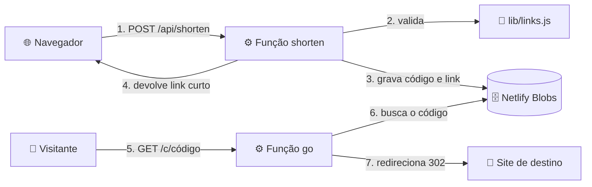

# 🐱 Miau Links: Encurtador de Links 🐾

Aplicação web 😺 que transforma um link comprido em um link curtinho 🔗. Você cola o endereço, o gatinho devolve o link curto ✂️, e quem abrir o link curto é levado ao site original 🚀.

🔗 **Site online:** (https://miaulinks.netlify.app/) 
🐙 **Repositório:** https://github.com/MizzieWiller/MiauLinks

> 🎓 Projeto da atividade de **Documentação de Software** (Fatec, disciplina de Sistemas Operacionais).

---

## 🗺️ Sumário

| | | |
|---|---|---|
| 🎯 1. Objetivo | 🤔 2. Problema | 📐 3. Escopo |
| 📋 4. Requisitos | 🧰 5. Tecnologias | 🏛️ 6. Arquitetura |
| 🗂️ 7. Estrutura | ✅ 8. Pré-requisitos | ⚙️ 9. Instalação e execução |
| 🔐 10. Variáveis de ambiente | 🔌 11. API | 🗄️ 12. Armazenamento |
| 🧪 13. Testes | 🚀 14. Deploy | 🛡️ 15. Segurança |
| 🤝 16. Contribuição | 🐛 17. Limitações | |

---

## 🎯 1. Objetivo

Oferecer uma página simples ✨, rápida ⚡ e sem cadastro 🙅 onde qualquer pessoa transforma um link longo em um link curto e compartilha o resultado 📤.

## 🤔 2. Problema

Links muito longos são difíceis de ler 👀, digitar ⌨️ e compartilhar 💬, e costumam quebrar quando copiados por partes. Um link curto resolve isso, e um **apelido personalizado** (como `gato-preto` 🐈‍⬛) deixa o endereço fácil de lembrar 🧠.

## 📐 3. Escopo

**✅ Dentro do escopo**
- ✂️ Encurtar links `http` e `https`;
- 🏷️ Apelido personalizado opcional;
- 🔀 Redirecionar o link curto para o destino original;
- 🙀 Página de "link não encontrado" para códigos que não existem;
- 📋 Botão para copiar o link curto;
- 📱 Interface responsiva, em português.

**❌ Fora do escopo**
- 🔑 Contas de usuário, login ou painel de links;
- 📊 Estatísticas de cliques;
- ⏳ Expiração, edição ou exclusão de links;
- 🚦 Proteção contra abuso em larga escala (veja a seção 17).

## 📋 4. Requisitos

### ⚙️ 4.1 Requisitos funcionais

| ID | Requisito | 📍 Onde no código |
|---|---|---|
| ✂️ RF01 | O usuário informa um link e recebe um link curto | `public/index.html`, `netlify/functions/shorten.mjs` |
| 🔒 RF02 | Aceitar só `http://` e `https://` e completar `https://` quando faltar | `lib/links.js` (`validateUrl`) |
| 🏷️ RF03 | Permitir um apelido de 3 a 24 caracteres (letras, números e hífen) | `lib/links.js` (`normalizeAlias`) |
| 🚫 RF04 | Recusar apelidos já usados ou reservados, com mensagem clara | `shorten.mjs`, `lib/links.js` |
| 🎲 RF05 | Sem apelido, gerar um código aleatório de 6 caracteres | `lib/links.js` (`generateCode`) |
| 🔀 RF06 | Abrir `/c/<código>` redireciona para o link original | `netlify/functions/go.mjs` |
| 🙀 RF07 | Código inexistente mostra página de erro amigável (HTTP 404) | `go.mjs` |
| 📋 RF08 | Copiar o link curto com um botão | `public/index.html` |

### 🛡️ 4.2 Requisitos não funcionais

| ID | Requisito |
|---|---|
| 🪶 RNF01 | **Simplicidade:** sem servidor próprio e sem banco para instalar; roda em funções serverless. |
| 🔐 RNF02 | **Segurança:** links `javascript:`, `data:` e similares são recusados; limite de 2048 caracteres por link. |
| ♿ RNF03 | **Acessibilidade:** campos com `label`, foco visível, erros anunciados por leitores de tela (`role="alert"`) e animação desligada com `prefers-reduced-motion`. |
| 📱 RNF04 | **Responsividade:** usável em celular e desktop. |
| 🧩 RNF05 | **Manutenibilidade:** regras de negócio isoladas em `lib/links.js` (funções puras e testadas). |
| 🌐 RNF06 | **Portabilidade:** funciona em qualquer conta Netlify, sem configuração extra. |

## 🧰 5. Tecnologias

| Camada | Tecnologia | 🔧 Uso |
|---|---|---|
| 🎨 Interface | HTML, CSS e JavaScript puros | Página única, sem framework |
| 🔤 Fontes | Google Fonts (*Bagel Fat One*, *Nunito*) | Visual do tema; há fontes alternativas se não carregarem |
| ⚙️ Backend | **Netlify Functions** (Node.js) | `POST /api/shorten` e `GET /c/:code` |
| 🗄️ Armazenamento | **Netlify Blobs** (`@netlify/blobs`) | Guarda `código → link` |
| 🧪 Testes | `node:test` (nativo do Node.js) | Testes das regras de negócio |
| ☁️ Hospedagem | **Netlify** | Site, funções e deploy automático |

## 🏛️ 6. Arquitetura



### 🧩 Componentes principais

| Componente | 🎯 Responsabilidade |
|---|---|
| 🎨 `public/index.html` | Formulário, chamada à API, exibição e cópia do resultado |
| ✂️ `netlify/functions/shorten.mjs` | Recebe o link, valida, gera ou confere o código e grava |
| 🔀 `netlify/functions/go.mjs` | Busca o código e redireciona; devolve a página 404 se não existir |
| 📐 `lib/links.js` | Regras puras: validar link, validar apelido e gerar código |

### 🧠 Decisões de projeto

| Decisão | 🤔 Por quê |
|---|---|
| 🗄️ Netlify Blobs em vez de banco externo | Zero configuração: nada para criar, conectar ou proteger com senha |
| 🔀 Redirecionamento `302` (não `301`) | Evita que o navegador guarde o destino em cache para sempre |
| 🔤 Alfabeto sem `i`, `l`, `o`, `0`, `1` | Evita confusão ao ler ou digitar o código |
| 📐 Regras em `lib/`, separadas das funções | Dá para testar sem rede e sem Netlify |

## 🗂️ 7. Estrutura do projeto

```
📁 MiauLinks/
├── 📂 public/             # 🌐 site estático
│   └── 📄 index.html      # 🎨 interface (HTML + CSS + JS)
├── 📂 netlify/
│   └── 📂 functions/
│       ├── ✂️ shorten.mjs # POST /api/shorten
│       └── 🔀 go.mjs      # GET /c/:code
├── 📂 lib/
│   └── 📐 links.js        # regras puras (validação e geração de código)
├── 📂 tests/
│   └── 🧪 links.test.js   # testes automatizados
├── ⚙️ netlify.toml        # publicação e funções
├── 📦 package.json        # dependências e scripts
├── 🙈 .gitignore          # ignora node_modules, .env e .netlify
└── 📘 README.md           # 📚 esta documentação
```

> ⚠️ O `netlify.toml` manda publicar a pasta `public/`. O `index.html` precisa ficar **dentro** dela, e o `package.json` e o `netlify.toml` na **raiz** do repositório.

## ✅ 8. Pré-requisitos

| Item | 🔢 Versão | Obrigatório? |
|---|---|---|
| 🟢 Node.js | 18 ou superior (recomendado 20+) | ✅ Sim (testes e ambiente local) |
| 📦 npm | Vem com o Node.js | ✅ Sim |
| 🌿 Git | 2.x ou superior | 📥 Para clonar e versionar |
| ☁️ Conta no Netlify | Gratuita | 🚀 Para publicar |
| 🛠️ Netlify CLI | Via `npx`, sem instalar | ➖ Opcional (rodar localmente com funções) |

## ⚙️ 9. Instalação e execução

```bash
# 1️⃣ Clonar o repositório
git clone https://github.com/MizzieWiller/MiauLinks.git

# 2️⃣ Acessar a pasta
cd MiauLinks

# 3️⃣ Instalar as dependências
npm install

# 4️⃣ Rodar localmente (site + funções)
npx netlify-cli dev
```

🌐 **5️⃣ Acessar:** http://localhost:8888
🐱 **6️⃣** Cole um link, clique em **Encurtar link** e teste o link curto gerado.
🧪 **7️⃣ Testes:** `npm test`

> 💡 O Netlify CLI simula as funções e o armazenamento no seu computador. Os dados do ambiente local **não** vão para o site publicado.

### 🩺 Como validar o ambiente
- 🐱 A página abre com o gatinho espiando pela caixa;
- ✂️ Ao encurtar `https://example.com`, aparece um link como `localhost:8888/c/abc234`;
- 🔀 Abrir esse link leva para `example.com`;
- 🙀 Abrir `/c/naoexiste` mostra "Esse link não existe".

### 🧯 Erros comuns

| 😵 Sintoma | 🔍 Causa provável | 🛠️ Solução |
|---|---|---|
| 🚫 "Page not found" no site publicado | `index.html` fora de `public/`, ou arquivos dentro de uma subpasta do repo | Deixe `package.json`, `netlify.toml` e `public/` na raiz e faça novo deploy |
| 🔑 O CLI pede login ou para vincular um site | Primeira execução | Siga o terminal ou use `npx netlify-cli dev --offline` |
| 🔌 Porta 8888 em uso | Outro programa usando a porta | Feche o outro programa ou use `--port 9999` |
| 🏷️ "Esse apelido já está em uso" | Apelido cadastrado antes | Escolha outro apelido |
| ❌ `npm install` falha | Node.js antigo | Atualize para Node 18+ |

## 🔐 10. Variáveis de ambiente

🚫 O projeto **não exige nenhuma variável de ambiente**. O Netlify Blobs é configurado automaticamente pela plataforma, e o endereço do link curto é calculado a partir do endereço do site.

Se você adicionar variáveis no futuro (como chaves de API 🔑):

| ✅ Faça | ❌ Não faça |
|---|---|
| Guardar em um `.env` local (já está no `.gitignore`) | Commitar o `.env` ou colar valores reais no README |
| Cadastrar no Netlify em *Site configuration → Environment variables* | Deixar tokens dentro do código |
| Documentar só o **nome** e a finalidade, com exemplos como `sua_chave_aqui` | Expor senhas, tokens ou dados de clientes |

## 🔌 11. API

Base: o mesmo endereço do site 🌐. Respostas em JSON, exceto o redirecionamento.

### ✂️ `POST /api/shorten`

Cria um link curto.

| Campo | 🏷️ Tipo | Obrigatório | 📝 Descrição |
|---|---|---|---|
| `url` | texto | ✅ sim | Link de destino (`http` ou `https`, até 2048 caracteres) |
| `alias` | texto | ➖ não | Apelido de 3 a 24 caracteres (letras, números, hífen) |

```bash
curl -X POST http://localhost:8888/api/shorten \
  -H "Content-Type: application/json" \
  -d '{"url":"https://example.com/um/endereco/muito/longo","alias":"gato-preto"}'
```

**Resposta `201 Created`**

```json
{
  "code": "gato-preto",
  "url": "https://example.com/um/endereco/muito/longo",
  "shortUrl": "http://localhost:8888/c/gato-preto"
}
```

| 🔢 Status | 📝 Quando |
|---|---|
| ✅ `201` | Link criado |
| ⚠️ `400` | JSON inválido, link inválido ou apelido fora do formato/reservado |
| 🚫 `405` | Método diferente de `POST` |
| 🏷️ `409` | Apelido já em uso |
| 🔧 `503` | Não foi possível gerar um código livre (raro; tente de novo) |

Os erros têm o formato `{ "error": "mensagem explicando o problema" }`.

### 🔀 `GET /c/:code`

Redireciona (`302`) para o link original. Se o código não existir, devolve uma página HTML com status `404` 🙀.

## 🗄️ 12. Armazenamento de dados

Não há banco relacional. Os links ficam no **Netlify Blobs**, um armazenamento chave-valor gerenciado pela Netlify.

| 🔑 Item | 📄 Valor |
|---|---|
| Store | `links` |
| Chave | O código do link (ex.: `abc234` ou `gato-preto`) |
| Valor | JSON com o destino e a data de criação |

```json
{ "url": "https://example.com/um/endereco/muito/longo", "createdAt": "2026-11-24T12:00:00.000Z" }
```

🧹 Para ver ou apagar os dados do site publicado, use o painel da Netlify (seção **Blobs**) ou a CLI.

## 🧪 13. Testes

### 🤖 Automatizados

```bash
npm test
```

Os testes ficam em `tests/links.test.js` e cobrem as regras de `lib/links.js`:

| 🧪 Teste | 🎯 O que verifica |
|---|---|
| 🎲 Geração de código | Tamanho correto e só caracteres do alfabeto permitido |
| 🔗 Validação de link | Aceita `http`/`https`, completa `https://`, recusa `javascript:`, `ftp:`, `data:`, vazio, host sem ponto e link longo demais |
| 🏷️ Validação de apelido | Aceita vazio, normaliza maiúsculas, recusa formato inválido e apelidos reservados |

### 👣 Roteiro manual (funções e interface)

| # | 👣 Passo | 🎯 Resultado esperado |
|---|---|---|
| T01 | 🌐 Abrir a página | Gatinho e formulário visíveis |
| T02 | ✂️ Encurtar `https://example.com` sem apelido | Link curto com código de 6 caracteres |
| T03 | 🔀 Abrir o link curto gerado | Redireciona para `example.com` |
| T04 | 🏷️ Encurtar com o apelido `gato-preto` | Link `/c/gato-preto` |
| T05 | 🚫 Repetir o apelido `gato-preto` | Erro "Esse apelido já está em uso" |
| T06 | ⚠️ Enviar `javascript:alert(1)` | Erro "Só aceitamos links http:// ou https://" |
| T07 | ⬜ Enviar o campo vazio | Erro "Cole um link para encurtar" |
| T08 | 🙀 Abrir `/c/naoexiste` | Página "Esse link não existe" (status 404) |
| T09 | 📋 Clicar em **Copiar link** | Botão muda para "Copiado!" |
| T10 | 📱 Abrir em tela estreita (celular) | Layout em coluna única, sem rolagem horizontal |
| T11 | ⌨️ Navegar só com Tab/Enter | Todos os controles acessíveis, com contorno de foco |

## 🚀 14. Deploy

☁️ O site é hospedado no **Netlify**, conectado ao GitHub 🐙. Cada `git push` publica uma nova versão automaticamente 🔁.

1. 🐙 No Netlify: **Add new site → Import an existing project** e escolha o repositório;
2. ⚙️ Confirme as configurações (já vêm do `netlify.toml`):

| Campo | Valor |
|---|---|
| 📂 Publish directory | `public` |
| ⚙️ Functions directory | `netlify/functions` |
| 🏗️ Build command | vazio |

3. 🚀 Clique em **Deploy**. Ao terminar, o Netlify mostra o endereço público;
4. ✅ Teste: encurte um link no site e abra o link curto gerado.

> ⚠️ Arrastar a pasta para o *Netlify Drop* **não** instala as dependências das funções, e o encurtador não funciona. Use a conexão com o GitHub ou a CLI: `npx netlify-cli deploy --prod`.

## 🛡️ 15. Segurança

**✅ O que o projeto faz**
- 🔒 Aceita só `http` e `https` como destino, o que bloqueia `javascript:` e `data:`;
- 📏 Limita o tamanho do link e valida o formato do apelido;
- 🚧 Reserva apelidos que conflitariam com rotas (`api`, `c`, `admin`...);
- 🧱 Não usa `innerHTML` com dados do usuário (o link curto é inserido com `textContent`).

**🚫 O que nunca vai para o repositório**
- 🔑 Senhas, tokens e chaves de API;
- 📁 Arquivos `.env` (já ignorados pelo `.gitignore`);
- 📂 Pasta `.netlify/` (estado local do CLI) e `node_modules/`.

## 🤝 16. Como contribuir

1. 🍴 Faça um *fork* e crie uma branch: `git checkout -b feature/nome-da-melhoria`;
2. 📐 Regras de negócio novas vão em `lib/` e precisam de teste em `tests/`;
3. 🧪 Rode `npm test` e o roteiro manual da seção 13;
4. 🔀 Abra um **Pull Request** descrevendo o que mudou e por quê.

> ⚠️ Nunca commite senhas 🔑, tokens 🎟️ ou arquivos `.env` 📁.

## 🐛 17. Limitações conhecidas e próximos passos

- 🚦 **Sem limite de uso:** qualquer pessoa pode criar muitos links (sem *rate limiting*), o que abre espaço para abuso;
- 🕵️ **Sem verificação do destino:** o site não checa se o link leva a algo seguro;
- 🗑️ **Sem edição ou exclusão:** um link criado só pode ser removido direto no painel da Netlify;
- 🏁 **Condição de corrida rara:** dois pedidos simultâneos com o mesmo apelido podem passar pela checagem ao mesmo tempo;
- ♾️ **Links permanentes:** não existe expiração.

💡 **Ideias:** 📊 contador de cliques, ⏳ expiração de links, 🔑 painel para gerenciar os próprios links, 🚦 limite de criação por IP e 🤖 testes automatizados das funções.

---

🐾 Feito com carinho (e pelos de gato) para a aula 8 - Documentação de Software 😸
