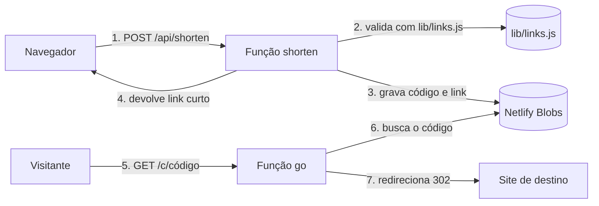

# 🐱 Miau Links

Encurtador de links com tema de gatinho. Você cola um endereço comprido, o gatinho devolve um curtinho, e quem abrir o link curto é redirecionado para o endereço original.

Projeto da atividade de **Documentação de Software** (Fatec, disciplina de Sistemas Operacionais).

| 🔗 | Endereço |
|---|---|
| Site | `https://SEU-SITE.netlify.app` *(troque pelo endereço do seu deploy)* |
| Repositório | `https://github.com/SEU-USUARIO/miau-links` *(troque pelo seu)* |

---

## Sumário

1. [Objetivo](#1-objetivo)
2. [Problema](#2-problema)
3. [Escopo](#3-escopo)
4. [Requisitos](#4-requisitos)
5. [Tecnologias](#5-tecnologias)
6. [Arquitetura](#6-arquitetura)
7. [Estrutura do projeto](#7-estrutura-do-projeto)
8. [Pré-requisitos](#8-pré-requisitos)
9. [Instalação e execução](#9-instalação-e-execução)
10. [Variáveis de ambiente](#10-variáveis-de-ambiente)
11. [API](#11-api)
12. [Banco de dados](#12-banco-de-dados)
13. [Testes](#13-testes)
14. [Deploy](#14-deploy)
15. [Segurança e o que não versionar](#15-segurança-e-o-que-não-versionar)
16. [Limitações conhecidas](#16-limitações-conhecidas)
17. [Como contribuir](#17-como-contribuir)

---

## 1. Objetivo

Oferecer uma página simples onde qualquer pessoa transforma um link longo em um link curto, sem cadastro, e compartilha o resultado.

## 2. Problema

Links muito longos são difíceis de ler, digitar e compartilhar em mensagens ou redes sociais. Além disso, quebram com facilidade quando copiados por partes. Um link curto resolve isso, e um apelido personalizado (como `gato-preto`) deixa o endereço fácil de lembrar.

## 3. Escopo

**Dentro do escopo**
- Encurtar links `http` e `https`;
- Apelido personalizado opcional;
- Redirecionar o link curto para o destino original;
- Página de "link não encontrado" para códigos inexistentes;
- Interface web responsiva, em português.

**Fora do escopo**
- Contas de usuário, login ou painel de links;
- Estatísticas de cliques;
- Expiração, edição ou exclusão de links;
- Proteção contra abuso em larga escala (ver [Limitações](#16-limitações-conhecidas)).

## 4. Requisitos

### 4.1 Requisitos funcionais

| ID | Requisito | Onde no código |
|---|---|---|
| RF01 | O usuário informa um link e recebe um link curto | `public/index.html`, `netlify/functions/shorten.mjs` |
| RF02 | O sistema aceita só `http://` e `https://` e completa `https://` quando falta | `lib/links.js` (`validateUrl`) |
| RF03 | O usuário pode escolher um apelido (3 a 24 letras, números ou hífen) | `lib/links.js` (`normalizeAlias`) |
| RF04 | Apelidos já usados ou reservados são recusados com mensagem clara | `shorten.mjs`, `lib/links.js` |
| RF05 | Sem apelido, o sistema gera um código aleatório de 6 caracteres | `lib/links.js` (`generateCode`) |
| RF06 | Abrir `/c/<código>` redireciona para o link original | `netlify/functions/go.mjs` |
| RF07 | Código inexistente mostra uma página de erro amigável (HTTP 404) | `go.mjs` |
| RF08 | O usuário pode copiar o link curto com um botão | `public/index.html` |

### 4.2 Requisitos não funcionais

| ID | Requisito |
|---|---|
| RNF01 | **Simplicidade:** sem servidor próprio e sem banco para instalar; roda em funções serverless. |
| RNF02 | **Segurança:** links `javascript:`, `data:` e similares são recusados; limite de 2048 caracteres por link. |
| RNF03 | **Acessibilidade:** campos com `label`, foco visível, mensagens de erro anunciadas por leitores de tela e animação desativada para quem prefere menos movimento. |
| RNF04 | **Responsividade:** interface usável em celular e desktop. |
| RNF05 | **Manutenibilidade:** regras de negócio isoladas em `lib/links.js` (funções puras e testadas). |
| RNF06 | **Portabilidade:** funciona em qualquer conta Netlify, sem configuração extra. |

## 5. Tecnologias

| Camada | Tecnologia | Uso |
|---|---|---|
| Interface | HTML, CSS e JavaScript puros | Página única, sem framework |
| Fontes | Google Fonts (*Bagel Fat One*, *Nunito*) | Visual do tema; há fontes alternativas se não carregarem |
| Backend | **Netlify Functions** (Node.js) | `POST /api/shorten` e `GET /c/:code` |
| Armazenamento | **Netlify Blobs** (`@netlify/blobs`) | Guarda `código → link` |
| Testes | `node:test` (nativo do Node.js) | Testes das regras de negócio |
| Hospedagem | **Netlify** | Site, funções e deploy automático |

## 6. Arquitetura



| Componente | Responsabilidade |
|---|---|
| `public/index.html` | Formulário, chamada à API, exibição e cópia do resultado |
| `netlify/functions/shorten.mjs` | Recebe o link, valida, gera ou confere o código e grava |
| `netlify/functions/go.mjs` | Busca o código e redireciona; devolve a página 404 se não existir |
| `lib/links.js` | Regras puras: validar link, validar apelido, gerar código |

**Decisões de projeto**

| Decisão | Por quê |
|---|---|
| Netlify Blobs em vez de um banco externo | Zero configuração: nada para criar, conectar ou proteger com senha |
| Redirecionamento `302` (não `301`) | Evita que navegadores guardem o destino em cache para sempre |
| Alfabeto sem `i`, `l`, `o`, `0`, `1` | Evita confusão ao ler ou digitar o código |
| Regras em `lib/` separadas das funções | Dá para testar sem rede e sem Netlify |

## 7. Estrutura do projeto

```text
miau-links/
├── public/                # site estático
│   └── index.html         # interface (HTML + CSS + JS)
├── netlify/
│   └── functions/
│       ├── shorten.mjs    # POST /api/shorten
│       └── go.mjs         # GET /c/:code
├── lib/
│   └── links.js           # regras puras (validação e geração de código)
├── tests/
│   └── links.test.js      # testes automatizados
├── netlify.toml           # configuração de publicação e funções
├── package.json           # dependências e scripts
└── .gitignore             # ignora node_modules, .env e .netlify
```

## 8. Pré-requisitos

| Item | Versão | Para quê |
|---|---|---|
| Node.js | 18 ou superior (recomendado 20+) | Rodar testes e o ambiente local |
| npm | Vem com o Node.js | Instalar dependências |
| Git | Qualquer versão atual | Clonar e versionar |
| Conta no Netlify | Gratuita | Publicar o site |
| Netlify CLI | Uso via `npx`, sem instalar | Rodar localmente com funções |

## 9. Instalação e execução

```bash
# 1. Clonar o repositório
git clone https://github.com/SEU-USUARIO/miau-links.git

# 2. Acessar a pasta
cd miau-links

# 3. Instalar as dependências
npm install

# 4. Rodar localmente (site + funções)
npx netlify-cli dev
```

5. Acesse **http://localhost:8888** no navegador.
6. Cole um link, clique em **Encurtar link** e teste o link curto gerado.
7. Para rodar os testes: `npm test`.

> O Netlify CLI simula as funções e o armazenamento localmente. Os dados do ambiente local não vão para o site publicado.

### Como validar que está funcionando
- A página abre com o gatinho espiando pela caixa;
- Ao encurtar `https://example.com`, aparece um link como `localhost:8888/c/abc234`;
- Abrir esse link leva para `example.com`;
- Abrir `/c/naoexiste` mostra a página "Esse link não existe".

### Erros comuns

| Sintoma | Causa provável | Solução |
|---|---|---|
| `npx netlify-cli dev` pede para fazer login ou vincular site | Primeira execução do CLI | Siga as instruções do terminal ou use `npx netlify-cli dev --offline` |
| Porta 8888 em uso | Outro programa usando a porta | Feche o outro programa ou use `--port 9999` |
| "Esse apelido já está em uso" | O apelido foi cadastrado antes | Escolha outro apelido |
| `npm install` falha | Node.js muito antigo | Atualize para Node 18+ |

## 10. Variáveis de ambiente

**Este projeto não exige nenhuma variável de ambiente.** O Netlify Blobs é configurado automaticamente pela própria plataforma, e o endereço do link curto é calculado a partir do endereço do site.

Se você adicionar variáveis no futuro (por exemplo, chaves de API):

- guarde-as em um arquivo `.env` local, que já está no `.gitignore` e **nunca deve ser enviado ao Git**;
- no Netlify, cadastre-as em **Site configuration → Environment variables**;
- documente aqui só o **nome** e a finalidade, com valores de exemplo (`sua_chave_aqui`), nunca o valor real.

## 11. API

Base: o mesmo endereço do site. Respostas em JSON, exceto o redirecionamento.

### `POST /api/shorten`

Cria um link curto.

**Corpo da requisição**

| Campo | Tipo | Obrigatório | Descrição |
|---|---|---|---|
| `url` | texto | sim | Link de destino (`http` ou `https`, até 2048 caracteres) |
| `alias` | texto | não | Apelido de 3 a 24 caracteres (letras, números, hífen) |

**Exemplo**

```bash
curl -X POST http://localhost:8888/api/shorten \
  -H "Content-Type: application/json" \
  -d '{"url":"https://example.com/um/endereco/muito/longo","alias":"gato-preto"}'
```

**Resposta `201 Created`**

```json
{
  "code": "gato-preto",
  "url": "https://example.com/um/endereco/muito/longo",
  "shortUrl": "http://localhost:8888/c/gato-preto"
}
```

**Erros**

| Status | Quando |
|---|---|
| `400` | JSON inválido, link inválido ou apelido fora do formato/reservado |
| `405` | Método diferente de `POST` |
| `409` | Apelido já em uso |
| `503` | Não foi possível gerar um código livre (raro; tente de novo) |

Os erros têm o formato `{ "error": "mensagem explicando o problema" }`.

### `GET /c/:code`

Redireciona (`302`) para o link original. Se o código não existir, devolve uma página HTML com status `404`.

## 12. Banco de dados

Não há banco relacional. Os links ficam no **Netlify Blobs**, um armazenamento chave-valor gerenciado pela Netlify.

| Item | Valor |
|---|---|
| Store | `links` |
| Chave | o código do link (ex.: `abc234` ou `gato-preto`) |
| Valor | JSON com o destino e a data de criação |

```json
{ "url": "https://example.com/um/endereco/muito/longo", "createdAt": "2026-11-24T12:00:00.000Z" }
```

Para ver ou apagar os dados do site publicado, use o painel da Netlify em **Blobs** (ou a CLI).

## 13. Testes

```bash
npm test
```

Os testes ficam em `tests/links.test.js` e cobrem as regras de `lib/links.js`:

| Teste | O que verifica |
|---|---|
| Geração de código | Tamanho correto e só caracteres do alfabeto permitido |
| Validação de link | Aceita `http`/`https`, completa `https://`, recusa `javascript:`, `ftp:`, `data:`, vazio, host sem ponto e links longos demais |
| Validação de apelido | Aceita vazio, normaliza maiúsculas, recusa formato inválido e apelidos reservados |

As funções do Netlify (`shorten` e `go`) não têm testes automatizados; elas são verificadas manualmente, seguindo a seção [Como validar](#como-validar-que-está-funcionando).

## 14. Deploy

O deploy é feito pelo **Netlify conectado ao GitHub**, e cada `git push` publica uma nova versão automaticamente.

1. Envie o projeto para um repositório no GitHub.
2. No Netlify, clique em **Add new site → Import an existing project** e escolha o repositório.
3. Confirme as configurações (já vêm do `netlify.toml`):
   - **Publish directory:** `public`
   - **Functions directory:** `netlify/functions`
   - **Build command:** vazio
4. Clique em **Deploy**. Ao terminar, o Netlify mostra o endereço público do site.
5. Teste: encurte um link no site e abra o link curto gerado.

> ⚠️ Arrastar a pasta para o "Netlify Drop" **não** instala as dependências das funções. Use a conexão com o GitHub (ou `npx netlify-cli deploy --prod`).

## 15. Segurança e o que não versionar

**O que o projeto faz**
- Aceita só `http` e `https` como destino, o que bloqueia `javascript:` e `data:`;
- Limita o tamanho do link e valida o formato do apelido;
- Reserva apelidos que conflitariam com rotas (`api`, `c`, `admin`...).

**O que nunca vai para o repositório**
- Senhas, tokens e chaves de API;
- Arquivos `.env` (já ignorados pelo `.gitignore`);
- Pasta `.netlify/` (estado local do CLI) e `node_modules/`.

## 16. Limitações conhecidas

- **Sem limite de uso:** qualquer pessoa pode criar muitos links (sem *rate limiting*), o que abre espaço para abuso.
- **Sem verificação do destino:** o site não checa se o link leva a algo seguro.
- **Sem exclusão ou edição:** um link criado só pode ser removido direto no painel da Netlify.
- **Condição de corrida rara:** dois pedidos simultâneos com o mesmo apelido podem passar pela checagem ao mesmo tempo.
- **Links permanentes:** não existe expiração.

## 17. Como contribuir

1. Faça um *fork* e crie uma branch: `git checkout -b feature/nome-da-melhoria`;
2. Regras de negócio novas vão em `lib/` e precisam de teste em `tests/`;
3. Rode `npm test` antes de abrir o Pull Request;
4. Descreva no PR o que mudou e por quê.

---

Feito para a atividade de Documentação de Software, Fatec. 🐾
